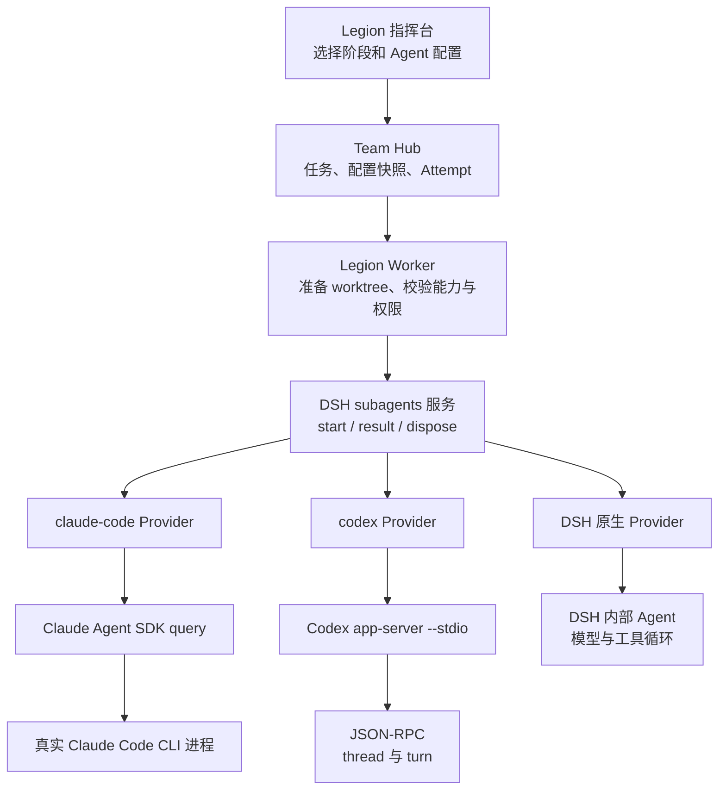
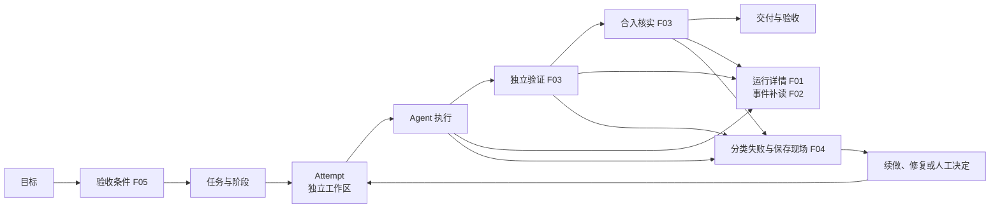
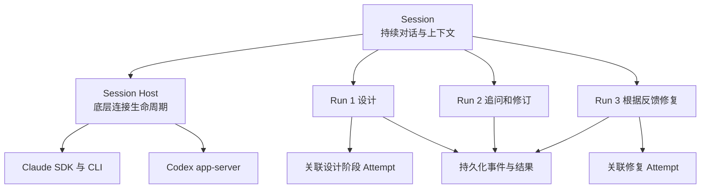
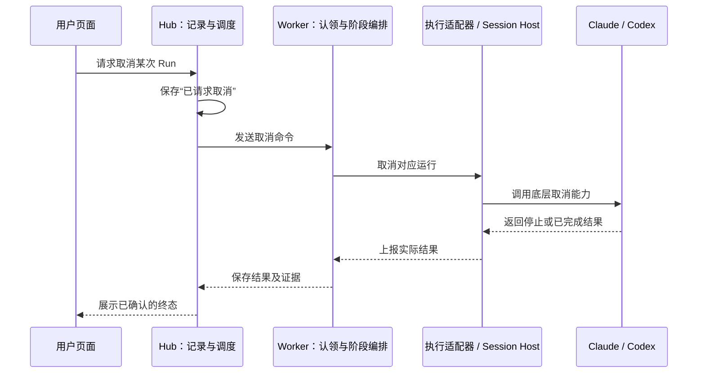
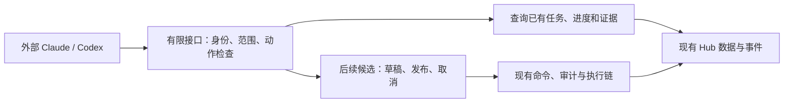

# CloudCLI 和 Quay 功能借鉴与 Legion Agent 接入讨论稿

状态：讨论稿，Q01 的优先方向已确认，Q02 至 Q06 待决策，尚未形成完整实施方案。版本：0.3。创建及更新日期：2026-10-10。

本稿整理 CloudCLI 与 Quay 中适合 Legion 借鉴的功能，说明 Legion 当前连接 Claude Code、Codex 和 DSH 原生 Agent 的方式，并记录后续需要讨论的产品与架构问题。功能编号 F01 至 F08、问题编号 Q01 至 Q06 保持稳定，后续可以按编号修改本稿。

Legion 已经通过 DSH Provider 调用外部 Agent。Claude Code 使用官方 Agent SDK，SDK 启动真实 CLI；Codex 使用官方 CLI 的 app-server 模式，通过标准输入输出上的 JSON-RPC 通信。下一步值得讨论的是运行可观察性、失败恢复和持续会话，而不是重新建立一套基础 CLI 调用。

## 研究范围与依据

本地现状以 2026-10-10 检出的源码为依据：Legion HEAD 为 `3f48b02ccb2eac68a90ac2d7c083869a6041ce05`，DSH HEAD 为 `5badb15009ae1756c3afe0ae0cef1faafc290ccc`。工作区中的未提交内容也属于本次读取范围；这两个提交号不代表当前已安装或运行的版本。本文没有将源码能力等同于当前节点已注册、已认证或已启用的能力。

外部项目研究对象为 [yaleh/claudecodeui](https://github.com/yaleh/claudecodeui) 的 develop 分支和 [yaleh/quay](https://github.com/yaleh/quay) 的 master 分支。CloudCLI 发布记录为 [v1.39.0](https://github.com/yaleh/claudecodeui/releases/tag/v1.39.0)，Quay 为 [v0.18.0](https://github.com/yaleh/quay/releases/tag/v0.18.0)。外部项目的运行稳定性仍需实际部署验证。

相关已有文档：[外部 Agent 工具接入能力与 Legion 接入方案](external-agent-tools-2026-09-30.md)。该文档保留跨 Agent 阶段协作、版本化交接和返工的详细设计；本稿聚焦功能借鉴和会话运行能力，不替代其工作流定义。

## 两个参考项目的职责

| 项目 | 主要职责 | 值得借鉴的重点 |
| --- | --- | --- |
| CloudCLI | 人与多种编程 Agent 交互的 Web 和桌面工作环境 | 会话与执行分层、事件补读、常驻进程、运行状态、MCP 控制 |
| Quay | 持续组织任务实施、检查和代码合入的开发系统 | 可执行判据、机械驱动、独立核实落地、失败升级、执行记录 |

两个项目已有实际关联：Quay 将 CloudCLI 分支列为驱动开发案例，CloudCLI 有 Quay 配置与观察面板。CloudCLI 的 Quay 面板使用只读命令白名单，不能由此推断其已经提供完整的 Quay 调度控制。

两边的 Provider 含义不同：CloudCLI Provider 适配编程 Agent；Quay Provider 适配任务存储，例如本地 Markdown 或 GitHub Issues。Quay 的存储可替换性不能直接推导为其自动开发执行引擎可以任意替换。

依据：[CloudCLI Provider 契约](https://github.com/yaleh/claudecodeui/blob/develop/server/modules/providers/README.md)、[Quay Core](https://github.com/yaleh/quay/blob/master/packages/quay/README.md)、[CloudCLI Quay 面板](https://github.com/yaleh/claudecodeui/blob/develop/server/modules/quay/quay.service.ts)。

## Legion 当前如何连接 Agent

| 工具 | 接入实现 | 本稿核实的一次性执行方式 |
| --- | --- | --- |
| Claude Code | 官方 Agent SDK `query()`；SDK 启动的进程由 DSH subprocess 服务接管 | 每次独立执行，`persistSession: false` |
| Codex | 启动包内官方运行组件的 `app-server --stdio`，使用 JSON-RPC | 每次创建进程和临时 thread，`ephemeral: true`，执行一个 turn |
| DSH 原生 Agent | 例如进程内 `spawn` Provider，由 Harness 创建子 Agent | 运行 DSH 自己的模型与工具循环，支持其原生能力契约 |

底层确实存在 CLI 进程，但外部 Agent 接入不是模拟终端键盘或解析终端画面。Legion 调用统一的 DSH 服务，由具体 Provider 处理 SDK、协议、子进程和结果。

Legion 在外部阶段派工前保存 Attempt，校验独立 worktree、父会话 cwd、冻结配置、Provider 注册和权限模式。返回结果经文本报告解析后继续进入阶段流程。Provider 声明的权限模式是配置核对依据，不替代真实文件访问验证或操作系统隔离。

Legion 当前外部工具配置声明文本输入、文本输出和取消能力；`sessionResume`、`outputSchema`、`toolFilter` 与 `localAgent` 为 false。它们描述的是当前适配器向 Legion 开放的能力，不能推导为 Claude 或 Codex 产品本身不具备相关功能。需要人工交互的外部调用也没有统一转成 Legion 中的交互审批界面。

源码入口：

- [Legion 外部执行适配器](../../runtime/adapters/dsh/external-agent.mjs)：`executeExternalAgent`。
- [Legion Worker](../../plugins/src/index.ts)：外部阶段的 Attempt 创建、派工与报告解析。
- [工具能力声明](../../workbench/src/components/AgentWorkflowConfigurator.tsx)：`EXTERNAL_CAPABILITIES`。
- [权限配置映射](../../runtime/contracts/agent-provider-policy.mjs)：`expectedExternalPermissionMode`。
- [DSH Claude 生命周期](../../../dsh/deepseek-harness/packages/subagent/subagent-claude-code/src/run.ts)：`claudeQueryOptions`、`startClaudeCodeRun`。
- [DSH Codex 生命周期](../../../dsh/deepseek-harness/packages/subagent/subagent-codex/src/run.ts)：`codexAppServerArgv`、`startCodexRun`。
- [DSH Codex 协议](../../../dsh/deepseek-harness/packages/subagent/subagent-codex/src/wire.ts)：`startThread`、`runTurn`。

## 可借鉴功能清单

下表的顺序是讨论建议，尚未批准为开发计划。“已有基础”不等于完整能力已经验收；实施前需要逐项核查生产链路和差距。

| 编号 | 功能 | 参考来源 | Legion 已有基础 | 建议补强方向 | 建议顺序 |
| --- | --- | --- | --- | --- | --- |
| F01 | 统一运行详情 | CloudCLI | Attempt、Run ID、阶段与执行节点记录 | 关联底层执行身份，展示执行、等待、验证、合入及终态 | 优先 |
| F02 | 实时事件补读 | CloudCLI | Hub 审计和 SSE 事件流 | 核查并补足 Agent 事件持久化、序号、断线补读与历史协调 | 优先 |
| F03 | 完成与落地独立核实 | Quay | 阶段报告、版本化交接物、测试证据与合入流程 | 将 Agent 返回、验证结果、提交、合入和产品验收分别记录并关联 | 优先 |
| F04 | 失败分类与续做 | Quay | 返工路由、取消、未知结果挂起与工作区保留 | 按启动、认证、权限、超时、验证、合入等失败分类，限定重试与续做入口 | 优先 |
| F05 | 可执行验收条件 | Quay | 目标、阶段输出契约和测试证据 | 将目标要求绑定到独立检查器，保存版本、判词和证据 | 第二步 |
| F06 | 执行总览与资源管理 | 两者 | 守护并发、节点心跳与进程托管 | 核实实际在飞数、进程归属、耗时与资源压力，控制并发并回收残留进程 | 第二步 |
| F07 | 持久会话与常驻宿主 | CloudCLI | 统一 Provider 调用和会话身份基础 | 按能力开放恢复或续接；设计伙伴可持续对话，任务执行仍保留 Attempt 边界 | 后续 |
| F08 | 外部 MCP 控制面 | CloudCLI | Hub API、操作者与审计体系 | 暴露查询、发送、停止等明确操作，复用权限与审计，保留单一任务事实源 | 后续 |

F01 和 F02 的参考是 CloudCLI 的服务端 Run、事件序号、补读缓冲与持久化历史协调：[聊天运行架构](https://github.com/yaleh/claudecodeui/blob/develop/docs/architecture/README.md)。浏览器连接只负责观察和交互，不承担执行生命周期。

F03 至 F05 的参考是 Quay 的独立检查与机械推进：[Promotion Driver](https://github.com/yaleh/quay/blob/master/plugin/scripts/promotion-driver.ts)、[Worker Driver](https://github.com/yaleh/quay/blob/master/plugin/scripts/worker-driver.ts)、[Fan-in](https://github.com/yaleh/quay/blob/master/plugin/scripts/worker-fan-in.ts)。Agent 自述完成、进程退出和代码真实落地需要分别确认；验收判据也应避免只验证实现自己定义的行为。

F06 的实现需要适配 Windows。CloudCLI 的 systemd 和 cgroup 隔离方案不能直接用于 Legion 当前主要环境：[进程隔离说明](https://github.com/yaleh/claudecodeui/blob/develop/docs/operations/process-isolation-and-memory-caps.md)。

F07 和 F08 的参考分别是 [Session Host](https://github.com/yaleh/claudecodeui/blob/develop/server/modules/session-hosts/session-host-manager.service.ts) 和 [MCP 控制工具](https://github.com/yaleh/claudecodeui/blob/develop/server/modules/mcp-gateway/mcp-gateway.write-tools.ts)。不直接复制常驻会话的 bypass 权限策略；Legion 应按自身授权边界定义运行政策。

## 功能如何组成开发闭环

下图是建议的能力关系，不代表新链路已经实现。

事件应关联工作空间、任务、阶段 Attempt 和执行 Run。适配器能够提供的原生 thread、turn 或进程身份也应关联到这次运行；不支持的字段保留明确的未提供状态，不能以空值伪装为成功读数。

“Agent 返回成功”“检查通过”“提交存在”“合入成功”“用户验收”分别回答不同问题。F03 应首先检查现有证据之间能否可靠关联，而不是重复新增一套任务状态机。

## 持久会话与常驻进程的区别

Session 表示持续的对话和上下文；Run 表示一次执行；Session Host 表示承载底层 SDK、进程或协议连接的运行对象；Attempt 表示某次阶段执行尝试。以下是 F07 的候选分层，具体实体和关系尚待决定。

| 能力 | 解决的问题 | 不能单独保证的事情 |
| --- | --- | --- |
| 进程常驻 | 跨轮保留运行对象，减少重复启动 | 进程或宿主重启后仍可恢复上下文 |
| 会话持久化与恢复 | 跨进程继续对话 | 原工作区仍正确、原任务可以直接重试 |
| 任务续做 | 从已核实的工作状态继续实施 | 可复用同一会话或原进程 |

设计伙伴适合优先评估持续会话。实施和评审是否复用会话，需要同时考虑工作区绑定、上下文污染、交接物版本与权限变化。恢复执行前必须核对前次 Run 和实际副作用；未知结果不能自动按失败重派。

## 建议推进顺序与验收场景

建议先跑通一个节点和一个小任务，补齐必要的配置说明与诊断，再核查 F01 至 F04，使当前一次性执行可观察、可解释、可恢复；之后评估 F05 与 F06；最后选择一个持续设计对话场景验证 F07，并讨论 F08 的开放范围。配置可用性是根据用户“当前节点功能不会用”的反馈补充的前提，不表示现有配置链路已经验证失败。用户已通过 Q01 确认“先跑通现有工作流，补齐执行详情与恢复”；之后各项的具体顺序和边界仍待讨论。

| 场景 | 应确认的行为 |
| --- | --- |
| 页面刷新或网络断开 | 执行身份保持一致，重连后补回事件，不重复显示或重复派工 |
| Agent 返回成功但验证失败 | 运行结果与验证判词分别保存，任务不自动作为交付完成 |
| Worker 或宿主重启 | 已有 Attempt 与工作区保留；未知结果等待核对，禁止未经核实重派 |
| 取消与完成同时发生 | 保留实际终态依据，区分取消请求和确认停止 |
| 常驻会话绑定的工作区变化 | 重新校验绑定和权限，不能将旧 cwd 或旧授权静默用于新工作区 |
| 子进程失控或残留 | 可识别归属、限制影响范围并确认回收结果；Windows 上单独验收 |

这些是后续验证要求，不是已通过的测试记录。

## 待讨论问题

| 编号 | 问题 | 当前建议 | 状态 |
| --- | --- | --- | --- |
| Q01 | 首个投入方向是执行可观察性，还是持续设计对话 | 先跑通现有工作流，补齐执行详情与恢复；持续设计对话不作为首阶段重点 | 已确认优先方向 |
| Q02 | 哪些阶段允许持久会话，哪些阶段要求新会话 | 设计阶段先试；实施和评审保持独立 Attempt，会话复用另行判断 | 待决策 |
| Q03 | Session Host 的事实和操作分别归谁持有 | Hub 保存产品关联与记录；DSH 或节点执行层负责真实进程和协议连接 | 待决策 |
| Q04 | 第一版运行事件需要覆盖哪些信息 | 开始、工具、等待、取消、终态、验证和合入，并带可关联身份 | 待决策 |
| Q05 | 无人值守遇到交互问题如何处理 | 明确拒绝或挂起并记录原因；若开放人机交互，建立显式答复和超时机制 | 待决策 |
| Q06 | 是否开放外部 Agent 控制 Legion | 先限定查询与可审计操作，再讨论写权限和任务创建 | 待决策 |

## 讨论方式与使用场景

本轮是架构讨论与文档细化，尚未进入产品实现。用户明确希望理解现有节点功能、了解可以借鉴的能力，并形成可反复修改的文档。以下以“先在一台执行机器上理解并跑通现有流程”为建议起点；这不是用户已确认的长期部署限制。

六项问题分属推进顺序、上下文复用、运行职责、事件展示、人工介入和外部接口。它们需要相互一致，但不宜一次全部实现。Q01 已确认，接下来依次讨论 Q02 至 Q06；每项可以选择“接受推荐”“接受但修改边界”“暂缓”或“采用另一方案”。确认意见记录到对应条目与修订记录，不把没有反对当成同意。

下文每项的推荐都是候选方案。示例事件名、界面文案和新增实体用于说明预期行为，不能当成已有 API 或已实现功能。

### Q01：先让现有执行看得懂，还是先做持续设计伙伴？

**这项决定投入顺序。** 两个方向都可以保留，但第一阶段必须有一个可验收的主要目标。执行可观察性回答“任务到底在哪一步、为什么停、怎么继续”；持续设计对话回答“能否像和一个熟悉项目的伙伴一样反复讨论”。

例如，你发布“给登录页增加验证码”。方案设计、编码和评审可以分配给不同工具。如果页面只有“运行中”，你不知道是节点没接上、Agent 在执行、等你回答，还是代码写完后测试失败。这是前一方向。你在发布前连续讨论“是否需要验证码、触发条件是什么、隐私如何处理”，下一轮还能接着修改设计，这是后一方向。

| 方案 | 首先解决的问题 | 代价与局限 |
| --- | --- | --- |
| A，推荐：配置跑通，再补执行详情与恢复 | 现有节点会用，任务状态可信，失败原因明确 | 初期还没有完整的持续设计聊天体验 |
| B：先做持续设计对话 | 减少反复解释项目，直接改善需求讨论 | 会增加会话、恢复和交互问题；现有执行问题仍可能不透明 |
| C：两条一起推进 | 同时改善讨论与执行 | 涉及更多边界，第一版容易做得很宽却没有一条完整可用链路 |

**推荐 A。** 你当前遇到的直接障碍是现有功能难以理解，因此先完成一个最小闭环：登记并连接一个节点，核实所选工具实际可执行，保存工作流，发布一个小目标，查看设计、编码、评审和落地结果。首次试跑尽量固定到一个明确的节点，排除自动分派带来的理解成本。

配置说明应分别解释“节点登记”“心跳在线”“工具与权限能力匹配”“真实任务验证”。心跳在线不能代替工具登录成功；注册按钮不能代替启动执行服务。已有功能足够时先改善说明和入口，不默认重建调度系统。F01 至 F04 也应先核查已有能力，再补缺口。

**第一阶段的验收建议：** 你可以独立完成一次小任务，并能回答“谁在执行、执行到哪、产出了什么、失败要处理什么”。断开页面后仍能找到同一次执行；Agent 成功但测试失败时明确显示验证失败；结果未知时不自动重复派工。

**已确认（2026-10-10）：** 用户选择“先跑通现有工作流，补齐执行详情与恢复（推荐）”。据此将配置与试跑、执行详情和恢复作为首阶段方向，持续设计对话不作为首阶段重点。具体缺口、实现范围和验收步骤尚未定稿；本决定不代表当前节点已跑通，也不代表其余五项已获确认。

### Q02：哪些阶段要记住对话，哪些阶段应该重新开始？

**这项决定上下文的复用边界。** “重新开始”不表示丢弃项目资料：新 Agent 可以读取冻结的设计、代码和验收要求。“记住对话”也不表示可以自动继续执行旧任务：工作区、权限、版本和前次副作用仍需核实。

| 方案 | 优点 | 主要风险 |
| --- | --- | --- |
| A，推荐：设计可持续，实施与评审按独立尝试组织 | 设计讨论连贯，实施可追溯，评审保持独立视角 | 需要明确设计何时冻结、返工如何传递 |
| B：所有阶段共享长期对话 | 信息传递直观，少重复解释 | 编码与评审互相影响，旧指令和旧版本容易混入新任务 |
| C：所有阶段都从新会话开始 | 生命周期简单，任务边界清楚 | 多轮设计需要反复整理背景，体验较差 |

**推荐 A，具体边界如下：**

| 场景 | 推荐行为 | 必须保留的边界 |
| --- | --- | --- |
| 同一主题反复讨论方案 | 可以复用设计会话 | 发布执行时冻结一个设计版本；后续聊天修改不静默改变在跑任务 |
| 新任务或新一轮正式实施 | 建立独立 Attempt；第一版使用新会话 | 输入必须指向本轮设计与工作区 |
| 同一实施尝试内补充信息 | 若适配器支持，可在当前尝试内继续 | 不把新增一轮对话误计为新任务，也不覆盖既有运行记录 |
| 根据评审意见返工 | 明确建立返工 Attempt，并附上评审结论 | 是否复用原会话另行核实；第一版优先新会话 |
| 独立评审或返工后复审 | 使用新的评审会话 | 可读取前次评审结论，但不继承编码者的完整聊天上下文 |

这里“独立评审”指输入与执行边界独立，同一工具甚至同一模型也可以执行；不要求为了独立性购买另一种产品。

需要区分三个层次：保存对话记录、恢复 Agent 的原生上下文、让底层进程一直活着。仅保存消息并不代表能恢复原生会话。推荐先验证保存与恢复，再根据启动耗时评估常驻进程，避免把常驻作为持续对话的必备前提。

**现状限制：** 当前 Legion 外部 Agent 接入声明不支持 `sessionResume`，Claude 调用设置 `persistSession: false`，Codex 使用临时线程。上面的持续会话属于新增能力建议，不能直接通过现在的工作流下拉框打开。

**第一阶段的验收建议：** 设计改到 v2 时，按 v1 发布的任务仍能准确关联 v1；评审可以读取规定的交接物；返工产生新尝试，旧证据仍可查看。持续设计试验还需证明重启后上下文可以恢复，或明确显示无法恢复。

**待确认：** 是否接受“设计先持续、实施与评审先保持新会话”的默认规则，以及什么情况下值得增加实施会话复用。

### Q03：Hub 和执行节点各管什么？

**这项决定谁保存记录、谁实际操作进程。** Hub 可以理解为调度与记录中心；执行节点是实际运行 DSH、Claude 或 Codex 的机器。Session Host 是节点上管理某段底层连接生命周期的运行对象，不是另一个 AI 岗位，也不一定需要做成独立服务。

| 方案 | 职责划分 | 代价与局限 |
| --- | --- | --- |
| A，推荐：Hub 保存关联、命令和可查询记录，节点掌握真实进程 | 与目前通过执行节点运行工具的方式一致 | 必须处理命令送达、断线和状态核对 |
| B：Hub 直接持有所有 Agent 进程 | 单机时调用路径可能更短 | Hub 与执行环境耦合，后续多机器和节点本地凭据更难处理 |
| C：浏览器持有连接并主导运行 | 交互界面实现直观 | 关闭页面、网络切换和多端访问容易改变任务生命周期 |

**推荐 A。** 用户从页面提交动作，Hub 记录意图并交给执行节点；节点操作底层 SDK 或 CLI，再上报确认结果。Hub 持久保存接收到的事件与证据，页面从 Hub 查询。现有 Worker 仍负责认领与阶段编排；执行适配器负责与实际工具通信。

上图是候选职责关系，不表示目前已实现这一完整取消确认链。

关键规则是：Hub 中“已请求取消”不等于进程已经停止；节点断线不等于 Agent 失败；同一个节点 ID 重新连接不等于旧进程已经消失。需要用运行身份和执行实例代次等手段区分新旧执行，并在恢复时核实旧运行。具体字段应复用现有认领与身份机制，设计时再确定缺口。

登录凭据与实际工作目录留在执行环境；Hub 保存必要的权限模式、能力报告及关联信息，不能仅凭声明证明实际权限已经生效。节点可先缓存待上报事件，Hub 记录尚未收到结果的事实；不引入另一套与 Hub 竞争的任务完成判定。

**第一阶段的验收建议：** 页面关闭不结束运行；节点断线后显示“执行状态待核实”；取消请求与确认停止有独立记录；重新连接不会将旧运行误绑定到新进程。

**待确认：** 是否沿用“中心记录与调度、节点执行”的职责划分；Session Host 先作为执行层内部对象，还是已有明确需求要求独立部署。

### Q04：运行页面第一版应该给人看什么？

**这项决定展示什么事实，以及断线后能补回什么。** 原始日志很多，却不一定能回答你关心的问题。第一版优先展示可行动的状态、执行摘要和证据，再按需展开工具细节。

| 方案 | 展示内容 | 代价与局限 |
| --- | --- | --- |
| A，推荐：关键运行事件加按需展开的详情 | 清晰表达进度、等待、失败和产物 | 需要将不同工具的真实事件映射到统一含义 |
| B：完整输出流和终端优先 | 熟悉 CLI 的人能看到大量细节 | 信息量大；刷新补读、脱敏和存储成本更高 |
| C：只有开始与最终结果 | 实现范围小 | 长任务仍像黑盒，无法解释中间停顿 |

**推荐 A，首批事件建议如下。** 名称是说明用语，最终应映射到已有事件机制。

| 类别 | 用户看到的信息 | 判定边界 |
| --- | --- | --- |
| 启动 | 哪个任务、阶段、工具和节点开始执行 | 实际开始与排队等待分别表达 |
| 进度 / 工具活动 | 正在检查文件、编辑或运行检查；详情可展开 | 只展示适配器实际提供的事件，无法获取则显示未提供 |
| 等待 | 等人回答、等节点或其他明确原因 | 不根据“暂时没有输出”推测 Agent 在思考 |
| 取消 | 已请求取消、正在处理、确认停止或请求到达前已完成 | 不能在点击按钮时直接标记已停止 |
| 执行结果 | Agent 成功、失败、超时或状态待核实，以及已取得的产物 | Agent 成功不能直接代表交付完成 |
| 验证 | 检查命令、对应代码版本、结果和失败摘要 | 要关联检查对象，不能拿旧版本通过结果证明新版本 |
| 合入 | 待合入、合入失败、已核实落地及对应提交 | 提交存在不能代替已经落地 |

每条事件应能关联空间、任务、阶段 Attempt 与 Run，并带有事件身份、时间和来源。补读需要明确的顺序或游标与去重规则；工具原生身份可作为附加信息，缺失时不编造。用户不必直接面对这些字段，排查详情才展开。

页面推荐先展示一行明确状态，例如“代码已生成，测试失败，等待返工”，下方展示关键时间线与证据。Hub 已有审计与 SSE 能力，应先检查能否复用；Claude、Codex 的中间事件能否完整透传仍需单独验证。没有心跳或新事件时显示数据更新时间与连接状态，不随意给出剩余时间。

结果快照与事件历史分别保存：快照便于迅速看现状，历史解释如何到达现状。工具参数和日志需控制长度、处理凭据等敏感内容；第一版不要求收集模型内部推理或全量 token。

**第一阶段的验收建议：** 刷新页面后可以补回同一运行的关键事件；重复上报不重复展示；查看一次失败即可找到节点、原因、代码版本和下一步。

**待确认：** 是否以“简明状态 + 关键时间线 + 可展开详情”为第一版，而非将完整终端作为唯一主体。

### Q05：Agent 问问题或要求授权时怎么办？

**这项决定自动执行何时停下来，以及人怎样接手。** “无人值守”应理解为规则内自行运行，遇到超出规则的动作有明确出口；不能把所有提问都自动回答“同意”。

例如，“验证码失败三次还是五次触发”是需求选择；“要不要运行删除目录的命令”是工具授权；“需要重新登录 Codex”是执行环境问题。三种情况不应共用一个不加区分的确认按钮。

| 方案 | 行为 | 代价与局限 |
| --- | --- | --- |
| A，推荐：规则内自动，规则外明确等待人工或结束并保留现场 | 自动化范围明确，人能知道下一步 | 真正暂停再答复需要适配器支持，当前外部链路不能假设已有 |
| B：所有交互请求立即拒绝 | 适合严格无交互的小任务，结果容易确定 | 复杂需求容易中断，用户需要重新发起 |
| C：自动同意所有请求 | 表面上中断较少 | 不适合作为默认规则，可能超出用户授权或猜错需求 |

**推荐 A，分阶段提供：** 第一阶段先把当前拒绝交互或失败的原因讲清楚，保留工作区与执行证据，给出补充需求、修正配置或发起新尝试的入口。第二阶段再针对实际支持的工具，增加“问题展示—人工答复—继续执行”能力。界面先出现一个等待状态并不能证明底层可以暂停和恢复。

**当前限制：** 已读取的 Claude 适配器对交互提问、未授权工具请求等采用拒绝或取消机制。不能直接承诺它已支持页面内回答后继续。Codex 的交互行为也需要逐项验证，不能仅根据 app-server 协议能力推断 Legion 已经接通。

候选处理规则：

| 情况 | 建议处理 | 后续如何继续 |
| --- | --- | --- |
| 已授权范围内的常规读写和检查 | 依据冻结的权限策略执行 | 不要求用户每一步点击同意 |
| 影响验收的需求歧义 | 呈现具体问题，等待人工决定 | 答复成为可追溯输入；必要时修订设计并新建尝试 |
| 超出权限范围的工具动作 | 明确阻止并说明原因 | 仅接受绑定到具体动作的授权；不得擅自扩大整体权限 |
| 登录失效、凭据缺失或需要终端交互 | 提示在执行节点修正环境 | 核实旧执行后重新发起，不在普通聊天中索要凭据 |
| 等待超时 | 记录超时并保留已有产物 | 转人工处理，不默认答复、不无限自动重试 |

若以后建立人工答复记录，至少绑定具体 Run、问题或动作、工作区与有效期；运行结束或被取消后旧答复不能再生效。重启后如何答复取决于底层恢复能力；不支持时使用新尝试，并明确告诉用户。

**第一阶段的验收建议：** 被拒绝、需要人工、执行失败能区分；用户知道去哪里改、改什么；等待超时后没有偷偷继续，旧授权不会误用于新任务。

**待确认：** 是否接受“先解释当前交互失败与续做方式，再补真正的暂停答复”，以及首批人工介入是否优先处理需求澄清。

### Q06：外部 Claude / Codex 能不能直接操作 Legion？

**这项决定外部接口的范围。** 当前是 Legion 调用 Agent。开放 MCP 等控制接口后，方向还可以反过来：外部 Agent 查询 Legion 或请求 Legion 执行动作。后者是新增入口，不等于现有 CLI 调用已经具备反向控制。

| 方案 | 能力 | 代价与局限 |
| --- | --- | --- |
| A，推荐：先开放有限查询，写操作逐项加入 | 从外部会话查看进度和证据，保持现有调度入口 | 初期不能一句话执行所有管理操作 |
| B：第一版开放查询、建任务、发布和取消 | 外部 Agent 可完成更长链路 | 写权限、并发修改、重复请求与反馈回路一起进入范围 |
| C：暂不开放 | 集中完善现有页面和工作流 | 外部 Agent 暂需用户转述任务状态 |

**推荐以 A 作为后续方向，当前可先选择 C 暂缓实现。** 第一批只读查询可以包含任务列表、任务详情、运行进度、失败原因和交付证据；按调用者授权限定空间与任务。只读也需要权限边界，不能默认能访问所有项目或完整敏感日志。

第二批如果确有需求，可以增加“生成任务草稿”，再讨论“发布目标”“取消指定运行”“恢复任务”等动作。创建草稿也属于写入，应明确记录发起者与授权范围。发布、答复和取消可能触发真实执行，必须分别定义语义，不能仅因为它们都叫 MCP tool 就用同一权限。

上图是候选接口关系。接口应复用现有 Hub 的命令和审计，不能绕过认领与阶段检查直接启动另一套执行循环。重复请求要防止重复创建或重复派工；外部 Agent 与任务内部 Agent 的身份和权限需要区分，避免任务自己无限创建任务。第一版不建议提供任意 shell 转发接口。

用户可以为明确范围授予持续权限，并不要求每次查询都确认；超出已授权范围的写操作才另行处理。是否需要远程公开服务、多用户隔离和外网部署应另开需求，不从一个本地 MCP 查询入口扩张成平台工程。

**第一阶段的验收建议：** 授权 Agent 只能查询指定范围；接口返回与页面一致的状态和证据；将来允许写入时，每个动作可查发起者，重复请求不导致重复执行。

**待确认：** 是否将外部控制放到后续阶段；到时先只读查询，还是已有明确场景必须支持某一种写操作。

## 六项建议如何衔接

推荐的连贯选择是：Q01 先跑通与解释现有工作流；Q02 设计会话后续持续，实施与评审先独立；Q03 Hub 管记录、节点管执行；Q04 优先关键事件与证据；Q05 先处理当前失败出口，再实现可验证的人工答复；Q06 外部控制暂缓，后续从只读开始。

Q01 决定先做什么，不要求现在实现 Q02 至 Q06 的全部能力。Q03 与 Q04 为后续会话和交互提供可靠的身份与事件基础；Q02 若选择持续设计，Q05 的人工答复就需要提前评估。Q06 可以独立推迟，不影响页面内使用现有流程。

每轮讨论结束，应写清“确认了什么、暂缓了什么、还有什么没有证据”。例如接受 Q01 的推进顺序，只表示同意方向，不表示节点已经跑通，也不表示 F01 至 F04 的缺口清单和实现方案已经定稿。

## 修订记录

| 日期 | 版本 | 修改内容 | 决策变化 |
| --- | --- | --- | --- |
| 2026-10-10 | 0.1 | 整理项目定位、当前接入方式、八项候选功能、三张架构图和六项讨论问题 | 尚未形成实施决策 |
| 2026-10-10 | 0.2 | 逐项补充 Q01 至 Q06 的解释、方案比较、推荐边界、验收场景及两张图；依据节点使用反馈补充首次配置与试跑前提 | 六项仍待决策；进入逐项讨论，未授权产品实现 |
| 2026-10-10 | 0.3 | 记录用户对 Q01 的选择，并同步状态、优先顺序和讨论进度 | Q01 优先方向已确认；Q02 至 Q06 待决策，尚未形成完整实施方案 |

后续在本文件中修改对应条目，保留功能与问题编号；已确认的选择更新到正文，并在修订记录中说明。实施计划和任务应在需求确认后单独建立，避免把讨论建议当成已授权的开发范围。
